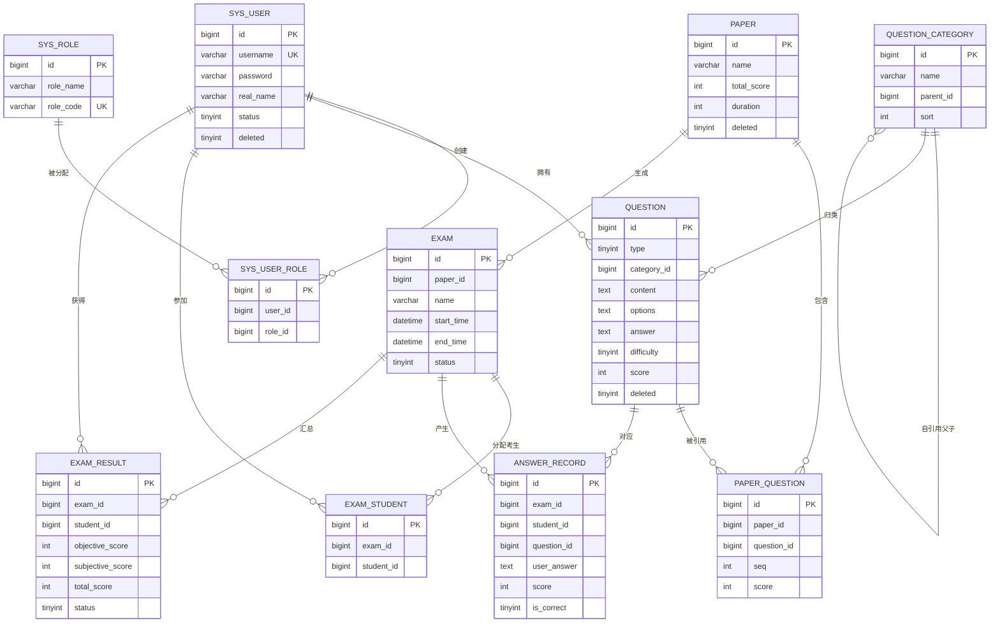

# 在线考试系统 · 数据库设计文档

> 《软件工程综合实践》第 2 周产出
> 数据库：MySQL 8.0，库名 `hxf_exam`，字符集 `utf8mb4`
> 建表脚本：`exam-backend01/sql/schema.sql`

---

## 1 设计约定

| 约定 | 说明 |
|---|---|
| 命名 | 表名、字段名一律小写下划线（`real_name`、`created_at`） |
| 主键 | 每张表都有 `id BIGINT AUTO_INCREMENT` |
| 时间 | 统一用 `created_at` 记录创建时间；需要记录变更的表加 `updated_at` |
| 逻辑删除 | 需要保留历史的表加 `deleted TINYINT`，0 未删 1 已删 |
| 外键 | **不建数据库外键**，引用完整性由业务代码保证（理由见第 5 节） |
| 关联表 | 多对多关系一律拆中间表，并加联合唯一键兜底 |

---

## 2 概念设计：ER 图

### 实体关系说明

| 关系 | 基数 | 说明 |
|---|---|---|
| 用户 ↔ 角色 | N : M | 通过 `sys_user_role` 中间表，联合唯一键 `(user_id, role_id)` |
| 分类 → 题目 | 1 : N | 一道题只属于一个分类 |
| 分类 → 分类 | 自引用 | `parent_id` 指向本表 id，`0` 表示顶级 |
| 试卷 ↔ 题目 | N : M | 通过 `paper_question`，额外存 `seq` 与 `score` |
| 试卷 → 考试 | 1 : N | 一张试卷可发起多场考试 |
| 考试 ↔ 学生 | N : M | 通过 `exam_student` 记录考生名单 |
| 考试 + 学生 + 题目 → 答题记录 | — | `answer_record` 一条记录对应一个学生某题的一次作答 |
| 考试 + 学生 → 成绩 | 1 : 1 | `exam_result` 联合唯一键 `(exam_id, student_id)` |

---

## 3 逻辑设计：11 张表清单

| 序号 | 表名 | 中文名 | 用途 | 删除策略 |
|---|---|---|---|---|
| 1 | `sys_user` | 用户表 | 三个角色的账号 | 逻辑删除 |
| 2 | `sys_role` | 角色表 | 固定三角色字典 | 不删除 |
| 3 | `sys_user_role` | 用户角色关联表 | 用户与角色的多对多 | 物理删除（先删后插） |
| 4 | `question_category` | 题目分类表 | 树形分类 | **物理删除** |
| 5 | `question` | 题目表 | 五种题型共用 | 逻辑删除 |
| 6 | `paper` | 试卷表 | 试卷基本信息 | 逻辑删除 |
| 7 | `paper_question` | 试卷题目关联表 | 试卷包含哪些题、各占多少分 | 物理删除 |
| 8 | `exam` | 考试表 | 一次考试的时间与状态 | 无 deleted |
| 9 | `exam_student` | 考试考生表 | 某场考试的考生名单 | 无 deleted |
| 10 | `answer_record` | 答卷记录表 | 学生每题作答与得分 | 无 deleted |
| 11 | `exam_result` | 成绩表 | 学生某场考试的总成绩 | 无 deleted |

---

## 4 数据字典

### 4.1 sys_user 用户表

| 字段 | 类型 | 允许空 | 默认 | 说明 |
|---|---|---|---|---|
| id | BIGINT | 否 | 自增 | 主键 |
| username | VARCHAR(50) | 否 | — | 账号，唯一键 `uk_username`；创建后不可修改 |
| password | VARCHAR(100) | 否 | — | 密码；长度 100 是为 BCrypt 密文（60 字符）预留余量 |
| real_name | VARCHAR(50) | 是 | NULL | 真实姓名 |
| status | TINYINT | 否 | 1 | 1 启用 / 0 禁用；禁用后无法登录 |
| created_at | DATETIME | 是 | CURRENT_TIMESTAMP | 创建时间 |
| updated_at | DATETIME | 是 | CURRENT_TIMESTAMP ON UPDATE | 更新时间 |
| deleted | TINYINT | 否 | 0 | 逻辑删除标记 |

### 4.2 sys_role 角色表

| 字段 | 类型 | 允许空 | 说明 |
|---|---|---|---|
| id | BIGINT | 否 | 主键，固定 1/2/3 |
| role_name | VARCHAR(50) | 否 | 给人看的名称：管理员 / 教师 / 学生 |
| role_code | VARCHAR(50) | 否 | 给程序判断的编码：ADMIN / TEACHER / STUDENT，唯一键 |
| description | VARCHAR(200) | 是 | 描述 |

初始数据：1 ADMIN 管理员、2 TEACHER 教师、3 STUDENT 学生。

### 4.3 sys_user_role 用户角色关联表

| 字段 | 类型 | 允许空 | 说明 |
|---|---|---|---|
| id | BIGINT | 否 | 主键 |
| user_id | BIGINT | 否 | 用户 id |
| role_id | BIGINT | 否 | 角色 id |

约束：`UNIQUE KEY uk_user_role (user_id, role_id)`，保证同一用户不会重复拥有同一角色。

### 4.4 question_category 题目分类表

| 字段 | 类型 | 允许空 | 默认 | 说明 |
|---|---|---|---|---|
| id | BIGINT | 否 | 自增 | 主键 |
| name | VARCHAR(50) | 否 | — | 分类名称；同一父分类下不可重名（业务层校验） |
| parent_id | BIGINT | 否 | 0 | 父分类 id；**0 表示顶级**，不允许 NULL |
| sort | INT | 否 | 0 | 同级排序，升序 |
| created_at | DATETIME | 是 | CURRENT_TIMESTAMP | 创建时间 |

无 `deleted` 字段：分类属字典类数据，物理删除。删除前必须检查子分类与关联题目。

### 4.5 question 题目表

| 字段 | 类型 | 允许空 | 默认 | 说明 |
|---|---|---|---|---|
| id | BIGINT | 否 | 自增 | 主键 |
| type | TINYINT | 否 | — | 1 单选 / 2 多选 / 3 判断 / 4 填空 / 5 简答；有索引 `idx_type` |
| category_id | BIGINT | 否 | 0 | 分类 id；有索引 `idx_category_id` |
| content | TEXT | 否 | — | 题干 |
| options | TEXT | 是 | NULL | 选项，JSON 数组字符串；仅选择题有值，其余为 NULL |
| answer | TEXT | 是 | NULL | 标准答案，格式随题型而变（见下） |
| analysis | TEXT | 是 | NULL | 解析 |
| difficulty | TINYINT | 否 | 1 | 1 简单 / 2 中等 / 3 困难 |
| score | INT | 否 | 5 | 题库建议分值，非试卷实际分值 |
| creator_id | BIGINT | 是 | NULL | 创建人；由后端从登录信息取，不由前端传 |
| created_at | DATETIME | 是 | CURRENT_TIMESTAMP | 创建时间 |
| deleted | TINYINT | 否 | 0 | 逻辑删除标记 |

**答案与选项格式约定**

| 题型 | type | options | answer 示例 |
|---|---|---|---|
| 单选 | 1 | JSON 数组字符串 | `B` |
| 多选 | 2 | JSON 数组字符串 | `A,C`（逗号分隔、已排序去重） |
| 判断 | 3 | NULL | `A` 表示对 / `B` 表示错 |
| 填空 | 4 | NULL | `北京,上海`（多空按顺序逗号分隔） |
| 简答 | 5 | NULL | 整段文本 |

### 4.6 paper 试卷表

| 字段 | 类型 | 允许空 | 默认 | 说明 |
|---|---|---|---|---|
| id | BIGINT | 否 | 自增 | 主键 |
| name | VARCHAR(100) | 否 | — | 试卷名称 |
| total_score | INT | 否 | 0 | 总分 |
| duration | INT | 否 | 60 | 考试时长（分钟） |
| creator_id | BIGINT | 是 | NULL | 创建人 |
| created_at | DATETIME | 是 | CURRENT_TIMESTAMP | 创建时间 |
| deleted | TINYINT | 否 | 0 | 逻辑删除标记 |

### 4.7 paper_question 试卷题目关联表

| 字段 | 类型 | 允许空 | 默认 | 说明 |
|---|---|---|---|---|
| id | BIGINT | 否 | 自增 | 主键 |
| paper_id | BIGINT | 否 | — | 试卷 id，有索引 |
| question_id | BIGINT | 否 | — | 题目 id |
| seq | INT | 否 | 0 | 题目在该卷中的顺序 |
| score | INT | 否 | 5 | 该题在这张试卷里的实际分值 |

> `paper_question.score` 与 `question.score` 的区别：前者是「这题在本次考试中值几分」，后者是题库建议值。同一道题在单元测里可值 2 分，期末考里可值 5 分。

### 4.8 exam 考试表

| 字段 | 类型 | 允许空 | 默认 | 说明 |
|---|---|---|---|---|
| id | BIGINT | 否 | 自增 | 主键 |
| paper_id | BIGINT | 否 | — | 使用的试卷，有索引 |
| name | VARCHAR(100) | 否 | — | 考试名称 |
| start_time | DATETIME | 否 | — | 开始时间 |
| end_time | DATETIME | 否 | — | 结束时间 |
| duration | INT | 否 | 60 | 时长（分钟） |
| pass_score | INT | 否 | 60 | 及格分 |
| status | TINYINT | 否 | 0 | 0 未发布 / 1 已发布 |
| creator_id | BIGINT | 是 | NULL | 创建人 |
| created_at | DATETIME | 是 | CURRENT_TIMESTAMP | 创建时间 |

### 4.9 exam_student 考试考生表

| 字段 | 类型 | 允许空 | 默认 | 说明 |
|---|---|---|---|---|
| id | BIGINT | 否 | 自增 | 主键 |
| exam_id | BIGINT | 否 | — | 考试 id，有索引 |
| student_id | BIGINT | 否 | — | 学生 id，有索引 |
| created_at | DATETIME | 是 | CURRENT_TIMESTAMP | 分配时间 |

### 4.10 answer_record 答卷记录表

| 字段 | 类型 | 允许空 | 默认 | 说明 |
|---|---|---|---|---|
| id | BIGINT | 否 | 自增 | 主键 |
| exam_id | BIGINT | 否 | — | 考试 id |
| student_id | BIGINT | 否 | — | 学生 id |
| question_id | BIGINT | 否 | — | 题目 id |
| user_answer | TEXT | 是 | NULL | 学生答案 |
| score | INT | 是 | NULL | 该题得分 |
| is_correct | TINYINT | 是 | NULL | 客观题是否正确：1 对 / 0 错 |
| created_at | DATETIME | 是 | CURRENT_TIMESTAMP | 作答时间 |

联合索引 `idx_exam_student (exam_id, student_id)`，用于「取出某个学生某场考试的全部作答」。

### 4.11 exam_result 成绩表

| 字段 | 类型 | 允许空 | 默认 | 说明 |
|---|---|---|---|---|
| id | BIGINT | 否 | 自增 | 主键 |
| exam_id | BIGINT | 否 | — | 考试 id |
| student_id | BIGINT | 否 | — | 学生 id |
| objective_score | INT | 否 | 0 | 客观题得分 |
| subjective_score | INT | 否 | 0 | 主观题得分 |
| total_score | INT | 否 | 0 | 总分 |
| status | TINYINT | 否 | 0 | 0 待阅卷 / 1 已完成 |
| submit_time | DATETIME | 是 | NULL | 交卷时间 |

约束：`UNIQUE KEY uk_exam_student (exam_id, student_id)`，保证一个学生某场考试只有一条成绩。

---

## 5 关键设计决策

### 5.1 为什么不建数据库外键

1. **删除变麻烦**：加了外键，删分类时数据库会自动报错或级联，而本项目要「先检查再给友好提示」，用业务代码做更可控。
2. **与逻辑删除冲突**：题目是逻辑删除（行还在），外键约束看不出「这个分类下的题其实已经删了」。
3. **迁移成本**：外键在分库分表、数据迁移时是负担。

代价是引用完整性只能靠业务代码保证（第 6 周的删除检查即为此设），必须明确知道「数据库这道防线是被主动放弃的」。

### 5.2 为什么题目逻辑删除、分类物理删除

判据是「这张表会不会被别的表引用」：

- 题目会被 `paper_question` 引用，真删会让历史试卷的引用悬空，所以逻辑删除。
- 分类只是题目的一个标签，删掉最多让题目少个归类，不会造成数据断裂，所以物理删除。

副作用：逻辑删除的题不算「该分类下的题」，所以一批题全被逻辑删除后分类可以删掉，留下「引用已删除分类的已删除题目」——记为已知缺口，第 14 周清理。

### 5.3 为什么 options 用 TEXT 存 JSON，不用 MySQL JSON 类型

本项目对 `options` 的读写全部在应用层完成，数据库从不解析其内部结构。用 JSON 类型带来的能力（库内校验、库内查询）一个都用不上，却要多写 TypeHandler 并处理类型转换。用 TEXT 当普通字符串最直接。

反过来说：如果将来要做「按选项内容搜索题目」，就应该换成 JSON 类型或拆出选项表。判断依据是「查询方式」，不是「数据长什么样」。

### 5.4 为什么 parent_id 用 0 表示顶级

| 方案 | 用 NULL | 用 0（本项目） |
|---|---|---|
| 字段约束 | 必须允许 NULL | NOT NULL DEFAULT 0，约束更强 |
| 查顶级 | `WHERE parent_id IS NULL` | `WHERE parent_id = 0` |
| Java 比较 | 空指针风险 | 普通 equals 即可 |

核心好处是不用处理 SQL 的三值逻辑：`parent_id = NULL` 永远返回未知，必须写 `IS NULL`，这类「看着对却查不出数据」的坑很难排查。用 0 之后，后端递归、前端新增、提交归一化三处都统一用 0。

### 5.5 为什么题目表有 score 还要在 paper_question 里再存 score

前者是题库建议值（这题大概值几分），后者是这道题在某张试卷里的实际分值。判分时用的是试卷里的分值。

---

## 6 初始化数据

`schema.sql` 执行后自带：

| 表 | 数据 |
|---|---|
| sys_role | 3 条：ADMIN / TEACHER / STUDENT |
| sys_user | 1 条：admin / 123456 / 系统管理员（首次登录后自动升级为 BCrypt 密文） |
| sys_user_role | 1 条：admin 拥有 ADMIN 角色 |

题目分类与题目数据由 `数据库/第6周-题库初始数据.sql` 提供（三级分类 2 / 11 / 22，五种题型各一道）。

> 注意：`schema.sql` 每张表都带 `DROP TABLE IF EXISTS`，重复执行会清空数据，仅在初始化时使用一次。
