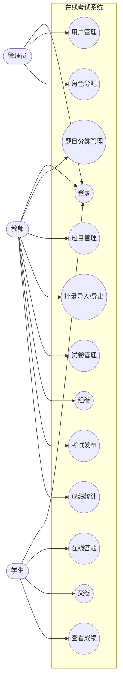

# 在线考试系统 · 需求规格说明书

> 《软件工程综合实践》第 1 周产出
> 项目：在线考试系统（PC 管理端 + 移动学生端）
> 版本：v1.2（第 6 周结束时回填实现状态）

---

## 1 引言

### 1.1 编写目的

本文档用于明确在线考试系统的功能范围与验收依据，作为后续设计、编码、测试的唯一依据。读者包括：开发者本人、课程指导教师、答辩评审。

### 1.2 项目背景

课程实训项目，目标是用 16 周从零完成一个覆盖「出题 → 组卷 → 考试 → 判分 → 统计」全流程的在线考试系统，替代纸质考试的组卷与阅卷环节。

### 1.3 术语定义

| 术语 | 含义 |
|---|---|
| 题库 | 题目与题目分类的集合 |
| 组卷 | 从题库中挑选题目组成一张试卷，并为每题设定分值 |
| 客观题 | 单选、多选、判断，可由程序自动判分 |
| 主观题 | 填空、简答，需人工阅卷或做文本比对 |
| 逻辑删除 | 只把 deleted 置为 1，数据仍保留在表中 |
| RBAC | 基于角色的访问控制，本项目固定管理员 / 教师 / 学生三角色 |

---

## 2 项目概述

### 2.1 系统目标

1. 管理员可维护用户与角色，是系统的唯一入口管理者。
2. 教师可维护题库、组卷、发布考试、阅卷并统计成绩。
3. 学生可在移动端查看考试、在线答题、交卷、查看成绩与解析。

### 2.2 系统范围

**做：**
- 三角色登录与权限区分
- 用户管理、题目分类管理、题目管理（含 Excel 批量导入导出）
- 试卷管理与组卷、考试发布与考生分配
- 在线答题、客观题自动判分、主观题阅卷
- 成绩查看与统计导出

**不做（明确排除）：**
- 实时视频监考、人脸识别
- 考试防作弊（切屏检测、题目乱序）
- 多租户 / 多学校隔离
- 消息推送、短信通知
- 角色自定义（三角色固定，不提供角色 CRUD）

### 2.3 用户角色

| 角色 | 端 | 核心职责 |
|---|---|---|
| 管理员 | PC | 用户与角色的唯一管理者 |
| 教师 | PC | 题库、试卷、考试、成绩的全流程负责人 |
| 学生 | 移动端（Uniapp） | 参加考试并查看成绩 |

---

## 3 功能需求

### 3.1 管理员功能

| 编号 | 功能 | 说明 |
|---|---|---|
| A1 | 登录 | 账号密码登录，进入管理端，签发 JWT |
| A2 | 用户列表 | 分页查看所有未删除用户，支持按账号 / 姓名搜索 |
| A3 | 新增用户 | 创建账号并设定角色、状态，密码以 BCrypt 存储 |
| A4 | 编辑用户 | 可改姓名、角色、状态；用户名一经创建不可修改 |
| A5 | 删除用户 | 逻辑删除，需二次确认 |
| A6 | 启用 / 禁用 | 禁用后该账号无法登录 |
| A7 | 重置密码 | 密码恢复为初始值 123456 |
| A8 | 分配角色 | 为用户指定一个角色，多对多关系落在 sys_user_role |

### 3.2 教师功能

| 编号 | 功能 | 说明 |
|---|---|---|
| T1 | 登录 | 账号密码登录，进入教师端 |
| T2 | 题目分类管理 | 树形展示任意层级分类，支持增删改；同级名称唯一；有子分类或有题目时禁止删除 |
| T3 | 题目管理 | 分页展示，支持按题型 / 分类 / 难度 / 关键字筛选；支持五种题型的增删改与预览 |
| T4 | 题目批量导入 | 用 Excel 一次导入多道题；合法行入库，非法行返回行号与中文原因 |
| T5 | 题目导出 | 按当前筛选条件导出 Excel，列与导入模板一致，可闭环再导入 |
| T6 | 试卷管理 | 试卷的增删改查（逻辑删除） |
| T7 | 组卷 | 手动选题或按规则随机组卷，并为每题设定该卷分值 |
| T8 | 考试管理 | 创建 / 编辑 / 删除考试，设置起止时间、时长、及格分 |
| T9 | 考生分配 | 选择参加某场考试的学生 |
| T10 | 发布考试 | 发布 / 撤销考试，发布后学生端可见 |
| T11 | 成绩管理 | 查看成绩、对主观题阅卷 |
| T12 | 成绩统计 | 图表统计与导出 |

### 3.3 学生功能

| 编号 | 功能 | 说明 |
|---|---|---|
| S1 | 登录 | 移动端账号密码登录 |
| S2 | 查看考试 | 待考 / 进行中 / 已结束三态 |
| S3 | 在线答题 | 作答五种题型，答案暂存 |
| S4 | 交卷 | 提交答案，客观题即时判分 |
| S5 | 查看成绩 | 查看分数、及格与否 |
| S6 | 查看解析 | 查看错题与题目解析（不返回标准答案给学生端以外的接口） |

### 3.4 用例图

> 说明：正式 UML 用例图应在 draw.io / ProcessOn 中用「小人 + 椭圆」绘制，此处用 flowchart 近似表达，语义一致。所有用例共享「登录」作为前置。

---

## 4 非功能需求

| 类别 | 要求 | 当前实现情况 |
|---|---|---|
| 性能 | 列表接口分页，单页 10 条时 SQL 数固定，不随数据量线性增长 | 已实现（第 6 周批量映射消除 N+1） |
| 安全 | 密码 BCrypt 存储；接口需登录后访问；JWT 24 小时过期 | 已实现（第 4 周） |
| 安全 | 按角色限制接口与页面访问 | 未实现，计划第 14 周 |
| 兼容 | 管理端支持 Chrome / Edge 最新版；学生端支持 Android / iOS | 管理端已验证 |
| 可用性 | 破坏性操作（删除、重置密码）需二次确认 | 已实现 |
| 可维护 | 统一响应体 R{code,message,data}，业务异常返回中文提示 | 已实现（第 5 周） |
| 数据 | 用户、题目、试卷使用逻辑删除，可恢复 | 已实现 |

---

## 5 需求实现状态对照（截至第 6 周）

| 编号 | 功能 | 状态 | 完成周次 |
|---|---|---|---|
| A1 | 登录 | 已完成 | 第 4 周 |
| A2~A8 | 用户与角色管理 | 已完成 | 第 5 周 |
| T1 | 登录 | 已完成 | 第 4 周 |
| T2 | 题目分类管理 | 已完成 | 第 6 周 |
| T3 | 题目管理 | 已完成 | 第 6 周 |
| T4 | 题目批量导入 | 未开始 | 第 7 周 |
| T5 | 题目导出 | 未开始 | 第 7 周 |
| T6~T12 | 试卷、组卷、考试、成绩 | 未开始 | 第 8 周起 |
| S1~S6 | 学生端全部功能 | 未开始 | 第 10~12 周 |

已知缺口与补做计划见 `docs/第6周-已知缺口汇总G1-G8.md`。
